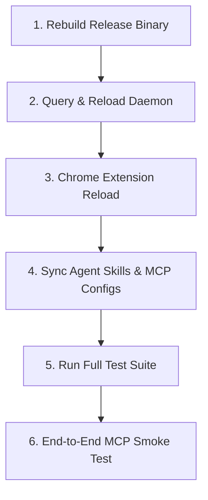

# OnlyDOMs — Update & Restart Protocol

This document defines the formal operational protocol for updating, rebuilding, and restarting the **OnlyDOMs** browser automation system across AI agent environments (Antigravity, Claude, Cursor, Windsurf) and local development workflows.

---

## 1. Trigger Conditions

Execute this protocol whenever:
- Source files in `mcp-server/` (`src/*.rs`, `Cargo.toml`, `Cargo.lock`) are modified.
- Chrome extension files in `extension/` (`background.js`, `content/`, `manifest.json`) are changed.
- Agent skill instructions (`skills/onlydoms/SKILL.md`) are updated.
- New commits are pulled from git (`git pull`).
- An AI agent or developer requests an OnlyDOMs restart or reports outdated binary behavior.

---

## 2. Standard 6-Step Update Protocol



### Step 1: Rebuild Release Binary
Compile the native Rust MCP server and daemon in optimized release mode:
```bash
cargo build --release --manifest-path mcp-server/Cargo.toml
```
- **Verification**: Ensure binary exists and is up to date at `mcp-server/target/release/onlydoms`.

---

### Step 2: Daemon Query & Zero-Downtime Reload
Check the status of the long-lived daemon:
```bash
mcp-server/target/release/onlydoms status
```
Expected output:
```json
{
  "service": "OnlyDOMs Daemon",
  "status": "running",
  "active_port": 9222,
  "extension_connected": true,
  "active_locks": []
}
```

- **If daemon is running**:
  Trigger a clean reload via IPC:
  ```bash
  mcp-server/target/release/onlydoms reload
  ```
  *(Note: If active tab leases are locked by an ongoing agent session, wait for tasks to finish before reloading).*
- **If daemon is not running**:
  Spawn it in the background:
  ```bash
  mcp-server/target/release/onlydoms daemon --port 9222 &
  ```
- **Verify**: Run `onlydoms status` again to verify `status: "running"` and `extension_connected: true`.

---

### Step 3: Chrome Extension Reload (When `extension/` Changes)
If any files under `extension/` were modified:
1. Open Chrome and navigate to `chrome://extensions/`.
2. Ensure **Developer mode** toggle is **ON** (upper right).
3. Locate the **OnlyDOMs** extension card.
4. Click the **Reload** icon (🔄).
5. Confirm the toolbar icon shows 🟢 **Connected** (Port `9222`).

---

### Step 4: Synchronize Global Agent Skills & MCP Configurations
Ensure agent clients have access to the latest skill definitions and MCP registration:

1. **Copy updated skill definition**:
   ```bash
   mkdir -p ~/.gemini/config/skills/onlydoms
   cp skills/onlydoms/SKILL.md ~/.gemini/config/skills/onlydoms/SKILL.md
   ```
2. **Verify MCP configuration**:
   Ensure `~/.gemini/config/mcp_config.json` points to the canonical release binary:
   ```json
   {
     "mcpServers": {
       "onlydoms": {
         "command": "/Users/rishabhrajgupta/Developer/chromapilot-browser-automation/mcp-server/target/release/onlydoms",
         "args": ["--port", "9222"]
       }
     }
   }
   ```
3. *(Alternative)*: Run `./setup.sh --register-antigravity` (or `./setup.sh --install`) to auto-sync all IDE configs.

---

### Step 5: Run Automated Regression Test Suite
Verify that all core components, sanitizers, and pipelines remain 100% green:
```bash
cargo test --release --manifest-path mcp-server/Cargo.toml
```
Critical target validation:
- `filter::hud_sanitizer` (ensures zero HUD pollution in DOM/CDP outputs)
- `tools::curl_runner` (verifies zero-subprocess Rust cURL replayer)
- `tools::report_builder` & `tools::testing` (verifies WebP -> HTML -> PDF pipeline)
- `tab_registry` (verifies multi-agent tab isolation leases)

---

### Step 6: End-to-End MCP Smoke Test
In the AI agent conversation, execute a single smoke test call using `call_mcp_tool`:

```json
{
  "name": "list_browser_sessions",
  "arguments": {
    "_intent": "Verify OnlyDOMs MCP connection and tab lock status post-update"
  }
}
```

Confirm that the tab registry resolves cleanly without socket or handshake errors.

---

## 3. Quick Reference Runbook (Copy-Paste)

```bash
# 1. Rebuild binary
cargo build --release --manifest-path mcp-server/Cargo.toml

# 2. Reload running daemon
mcp-server/target/release/onlydoms reload

# 3. Check health
mcp-server/target/release/onlydoms status

# 4. Sync skill definition
cp skills/onlydoms/SKILL.md ~/.gemini/config/skills/onlydoms/SKILL.md

# 5. Run tests
cargo test --release --manifest-path mcp-server/Cargo.toml
```
